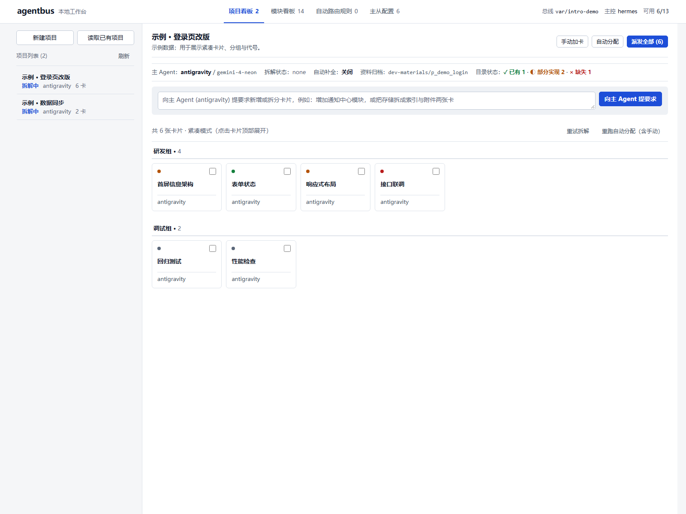

# agentbus 中文简介

`agentbus` 是面向**同一台电脑**上多个 coding agent 的**任务与指针总线**，而不是一个新的 Agent 框架。它保留各客户端原有的对话界面与执行能力，把跨 Agent 交接收口为“本地文件指针（`uri + sha256`）+ 租约状态机 + 任务内双向消息 + 哈希验收”，让多 Agent 协作可追踪、可核验且不重复拷贝大段上下文。

---

## 一、多 Agent 讨论与协作

在复杂研发任务中，多个 Agent 往往需要先讨论分工、暴露阻塞点、再汇总方案。`agentbus` 将同一台电脑上的多 Agent 协作固定在总线协议内（不做跨物理机通信）：

- **主从分工（Conductor / Worker）**：主控（`conductor`）负责建任务、拆解卡片、派发与最终汇总验收；执行方（`worker`）按最小权限领取任务并持租约工作，只通过 `bus_ref_read` 按指针读取所需资料，无法反向建任务或私自再派发。
- **任务内双向解阻**：执行方在实施中遇到需求歧义、环境冲突或卡点时，直接通过 `bus_task_message` 发送 `question`、`blocked` 或 `error`（同步标记阻塞时间），主控通过 `bus_task_message` 回复 `answer` 解阻；主控侧使用 `bus_task_wait` 阻塞等待任务进入终态或收到新的阻塞消息，无需重开对话或人工翻日志。
- **并行提案卡与主控裁决**：对于有多种技术路线的复杂问题，可拆成多张独立的**提案卡**，各自绑定不同的 Agent 与模型并行探索，独立产出带 `uri + sha256` 的结果文件；主控按 `acceptance` 验收条款逐一核对并比较合并，**不要把整段对话在多个客户端之间复制来复制去**。
- **轻量想法管理**：讨论过程中冒出的新想法应按规则及时落卡，详见 [`docs/TASK_CARDS.md`](TASK_CARDS.md)。

---

## 二、项目看板前端（`agentbus ui`）

运行 `agentbus ui --port 0 --no-open --root <bus-root>` 可启动零第三方前端依赖、无构建步骤的本地 Web 工作台。工作台严格**仅监听本机 loopback**（`127.0.0.1`、`localhost`、`::1`），模块看板提交请求默认只生成任务（需显式勾选或加 `--dispatch` 才立即派发）；项目看板新建项目按表单默认直发主 Agent 拆解，可在创建时关闭自动派发，且**不接触、不读取也不存储任何 token 或 API key**。

顶部包含四个页签：**项目看板**、**模块看板**、**自动路由规则**、**主从配置**。其中**项目看板**是当前日常协作主入口：

- **新建与读取已有项目**：支持新建项目（可选关联受控工作目录并交给主 Agent 自动拆解），也支持**读取已有项目**——在受控目录浏览器中选择允许根目录内的文件夹，自动扫描生成带有 `已有` / `部分实现` / `缺失` 状态的卡片，并可交主 Agent 复核。
- **分组、代号与紧凑模式**：卡片按任务环节分为**研发组（`dev`）**与**调试组（`debug`）**，每张卡片带项目内唯一的**模块代号（`code`）**。卡片数量 **≤ 4 张**时按分组展示完整卡片详情；**≥ 5 张**时自动切换为**紧凑**小方形卡片网格（仅展示功能名与负责 Agent），点击卡片顶部即可在看板顶部展开完整详情。
- **卡片内直接编辑与闭环动作**：每张卡片可直接修改负责 Agent 与模型（立即持久化到工作副本并支持撤销/恢复默认）；支持空缺字段**自动补全**、在项目顶部**向主 Agent 提要求**新增或拆分卡片、对已完成或已有部分触发**重生成**，以及点击**完成**生成归档任务，引导将开发过程产出归档到 `<workspace>/.agentbus/dev-materials/<module-code>/`。
- **默认串行派发**：在项目看板点击“派发全部”或“派发选中”时，默认按**串行**模式（`serial: true`）按卡片顺序推进——前一张真实进入 `done` 后才派发下一张；确需并行派发时，必须显式关闭串行（`serial: false`）。



> 示例数据，仅展示布局；紧凑模式。

关于四个页签的完整交互、受控目录校验与 HTTP API 契约，见 [`docs/UI.md`](UI.md)。

---

## 三、指针信封与任务生命周期

`agentbus` 不把资料正文塞进任务，只在本地磁盘保留原件，在总线中流转轻量指针信封：

- **指针信封（`tasks/<id>.json`）**：发活方通过 `bus_register` 就地登记文件，库中与信封里只记录 `uri`、`bytes`、`sha256`、`goal` 与 `acceptance`。参考任务实测中，登记 4 MB 文件时 SQLite 仅增约 48 KB，任务信封体积 2,025 B（对比复制正文的任务包 4,195,256 B）。领取方调用 `bus_ref_read` 时，≤ 64 KB 的文件直接内联返回，> 64 KB 只返回 `resource_link` 指针按 `uri` 自行读取。
- **状态机与租约**：任务按 `open -> claimed -> done | failed` 流转。领取时发放 `lease_token`（默认租约 900 秒），长任务通过 `bus_task_heartbeat` 续租；租约过期后任务自动回收到 `open` 并令 `attempt + 1`。
- **哈希验收**：调用 `bus_task_complete` 收工时，总线会重新计算全部引用文件的 `SHA-256`（源资料发生漂移默认拒收），并逐条核对 `acceptance`（如 `json`、`must_contain`、`min_bytes`、`fields`）以及产物哈希，全部通过才置为 `done`。




---

## 四、安装、客户端接入与最小流程

### 环境与安装

需要 **Node.js ≥ 22.13**（或 `23.4+`，直接调用内置 `node:sqlite`，零第三方运行时依赖）。当前版本通过离线 tarball 分发（暂未发布到 npm）：

```bash
npm install -g ./agentbus-mcp-0.4.1.tgz
agentbus setup
```

- `agentbus setup` 支持接入 Codex、Claude Code、Gemini CLI、Antigravity、Cursor、OpenCode、Claude Desktop、Windsurf、Kiro、LM Studio、Cline、DeepSeek Harness (DSH) 与 Hermes Agent，并可自动适配 WorkBuddy、CodeBuddy、VS Code、Trae、Qoder、OpenClaw、Zed（详见 [`docs/CLIENTS.md`](CLIENTS.md)）。
- 也可指定总线根目录与允许目录（或使用 `agentbus onboard` 交互分配 `conductor` / `worker` 与本地模型）：

```bash
agentbus setup --client codex --root ~/.agentbus --allow ~/projects/my-app
```

配置完成后需重启对应客户端以加载最新 MCP 环境变量。

### 最小可用流程（CLI / MCP）

```bash
# 1. 登记资料指针（只记录地址与哈希）
agentbus put ./specs/report.md --by planner

# 2. 创建任务并附带引用哈希与验收条款
agentbus new --to codex \
  --goal "按 specs/report.md 产出 report.json" \
  --ref <第1步输出的sha256> \
  --from planner \
  --accept json=true --accept must_contain=total_kwh

# 3. 领取任务并按 64 KB 阈值读取资料
agentbus claim <task-id> --by codex
agentbus ref   <task-id> --name report.md

# 4. 提交产物，总线重算引用哈希并跑完验收条款
agentbus done <task-id> --by codex --lease <token> --result ./out/report.json
```

在 MCP 客户端内对应工具为：`bus_register` → `bus_task_create` → `bus_task_claim` → `bus_ref_read` → `bus_task_message` / `bus_task_wait` → `bus_task_complete`。完整协议字段见 [`docs/PROTOCOL.md`](PROTOCOL.md)。

---

## 五、适用边界与限制

- **仅限本机协作**：资料引用使用 `file://` 本地路径，受 `AGENTBUS_ALLOWED_ROOTS`（含 `realpath` 防符号链接逃逸）约束；不做跨物理机网络传输。
- **无常驻守护进程**：MCP 默认走 stdio，UI 仅按需前台绑定 loopback；租约过期在后续读写操作时惰性回收。
- **分发与语言**：当前通过 `npm pack` 生成离线 tarball 安装；CLI 交互提示以中文为主，MCP 工具返回与语言无关的 JSON。
- **想法入卡规范**：日常讨论与任务拆分请遵循 [`docs/TASK_CARDS.md`](TASK_CARDS.md)，避免对话丢失或上下文膨胀。
