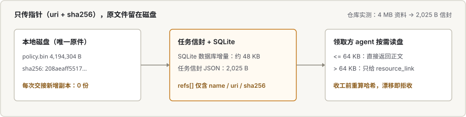
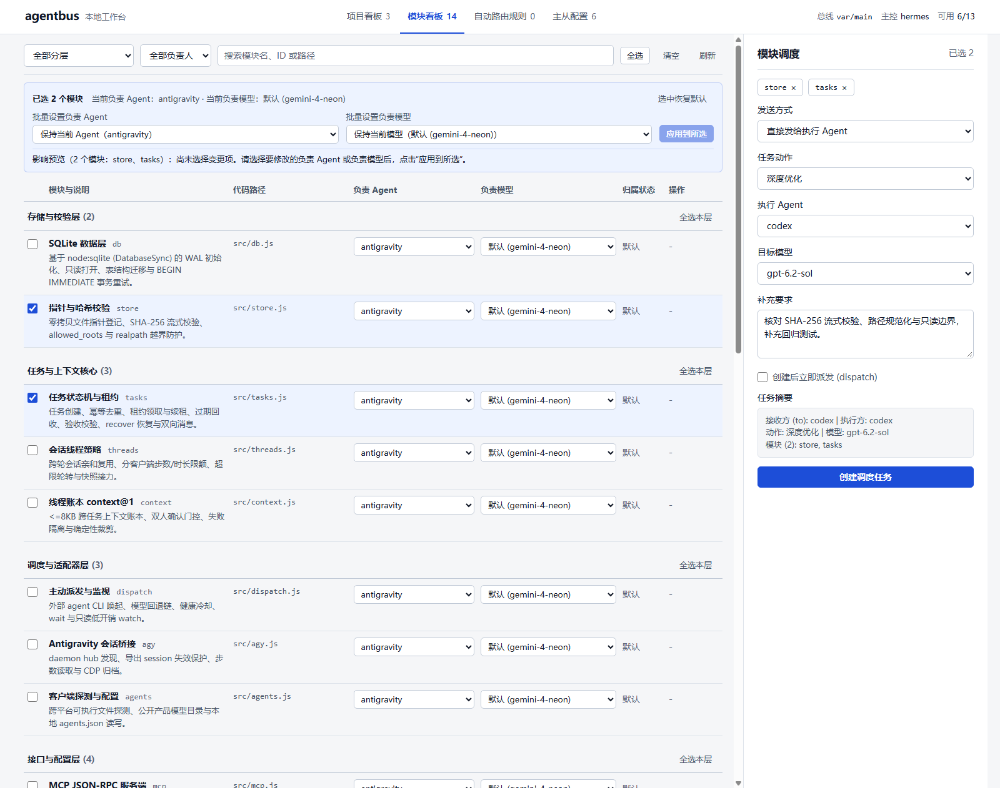

# agentbus 项目简介

`agentbus` 是给本机已有 coding agent 使用的轻量任务总线。它负责在多个本地客户端之间传递任务指针、管理租约状态并核验交付结果，保留各客户端原本的交互界面，也无需引入新的 agent 编排框架。

## 为什么需要它

本地同时使用多个 coding agent 协作时，常见的交接方式是把需求文档、日志、数据表整段塞进下一轮 prompt 或复制成临时任务包。实际跑下来往往会遇到四个具体问题：

- **资料反复复制且版本失控**：一份几 MB 的文件转手两三次后，磁盘与对话上下文里散落多份副本，源文档改过之后下游仍按旧稿干活。
- **执行状态不透明**：派发方只能看到子进程退出码，进程中途崩溃或卡死时无法自动回收任务。
- **遇阻缺乏通道**：执行方遇到信息缺失或环境冲突，往往只能把报错埋在终端输出里，主控端需要翻日志猜原因。
- **缺少客观验收**：多数交接默认采信对方回复的“已完成”，缺少对源资料一致性与结果格式的强制核对。

## 它和常见做法哪里不同

`agentbus` 把一次跨 agent 交接拆成可核验的协议步骤，和直接贴 prompt 或打包上下文有六处核心差异：

- **指针信封**：发活方通过 `bus_register` 就地登记文件，原文件留在本地磁盘，任务信封（`tasks/<id>.json`）里只写 `uri`、`sha256`、`goal` 与 `acceptance`。参考任务实测中，登记 4 MB 资料时 SQLite 仅增约 48 KB，任务信封体积 2,025 B（对比复制正文的任务包 4,195,256 B）。领取方调 `bus_ref_read` 时，不超过 64 KB 的文件直接内联，超过 64 KB 只返回 `resource_link` 指针。
- **租约与状态机**：任务状态严格按 `open -> claimed -> done | failed` 流转。领取时发放 `lease_token`，默认租约 900 秒，长任务通过 `bus_task_heartbeat` 续租；租约过期后任务自动回到 `open` 并令 `attempt + 1`，便于重试接管。
- **主从双向消息**：执行方遇阻时用 `bus_task_message` 发送 `question`、`blocked` 或 `error`（同步写入 `blocked_at`），主控回复 `answer` 后清除阻塞并唤醒 `bus_task_wait`，不必重新拼一轮任务。
- **可验证的完成**：调用 `bus_task_complete` 收工时，总线会重新计算全部引用文件的 `SHA-256`（源资料发生漂移默认拒收），并逐条核对 `acceptance` 条件（如 `json`、`must_contain`、`min_bytes`、`fields`），校验全部通过才置为 `done`。
- **现有客户端接入**：内置 MCP stdio 服务端与同能力 CLI，零第三方运行时依赖。`conductor` 角色开放 15 个工具，`worker` 角色按最小权限裁剪为 9 个工具（无法新建或再次派发任务）。`agentbus setup` 可自动写入 13 类客户端的配置文件，且写前自动备份。
- **模块归属面板**：`agentbus ui` 提供仅绑定本机 loopback 的只读面板，按技术分层列出 14 个模块的负责人与本地 `agents.json` 解析出的工作模型。勾选模块提交动作时默认只生成给 conductor 的调度任务，需要立即派发再显式勾选开关或加 `--dispatch`。



## 一条任务的生命周期


单条任务从 `bus_register` 登记文件指针开始，生成 `open` 状态信封，由执行方领取并持 900 秒租约工作；中途卡住可经 `bus_task_message` 提问并等待主控 `answer`；交回结果后由 `bus_task_complete` 重算引用哈希并跑完验收条款才进入 `done`。静态兜底图见 [`assets/agentbus-task-loop.zh.png`](assets/agentbus-task-loop.zh.png)。

## 界面

运行 `agentbus ui --port 0 --no-open --root <bus-root>` 后，可在浏览器打开本机模块归属面板，按分层筛选查看 14 个模块的负责人与工作模型，并勾选部分模块向主控提交重做、优化或检查任务（详见 [`UI.md`](UI.md)）：



## 最小可用流程

当前版本通过离线 tarball 分发（暂未发布到 npm）。安装并接入客户端后，重启客户端即可加载 MCP 服务：

```bash
npm install -g ./agentbus-mcp-0.3.0.tgz
agentbus setup --client codex --root ~/.agentbus --allow ~/projects/my-app
```

使用 CLI 跑通一次“登记资料 → 建任务 → 领取读盘 → 核验收工”：

```bash
# 1. 就地登记资料，只记录地址与哈希
agentbus put ./specs/report.md --by planner

# 2. 建任务并附验收条款（填入第 1 步返回的 sha256）
agentbus new --to codex \
  --goal "按 specs/report.md 产出 report.json" \
  --ref <第1步输出的sha256> \
  --from planner \
  --accept json=true --accept must_contain=total_kwh

# 3. 领取任务并按 64 KB 阈值读资料
agentbus claim <task-id> --by codex
agentbus ref   <task-id> --name report.md

# 4. 提交产物，总线重算引用哈希并校验验收条款
agentbus done <task-id> --by codex --lease <token> --result ./out/report.json
```

在支持 MCP 的客户端内，对应工具调用为 `bus_register`、`bus_task_create`、`bus_task_claim`、`bus_ref_read` 与 `bus_task_complete`。完整安装矩阵与协议字段见 [`README.md`](../README.md) 与 [`PROTOCOL.md`](PROTOCOL.md)。

## 适用边界与限制

- **仅限本机协作**：资料引用使用 `file://` 本地地址，且路径必须落在 `AGENTBUS_ALLOWED_ROOTS` 允许目录内（先做 `realpath` 解析防越界）；跨机协同需自行前置 HTTP 资料层。
- **Node 版本要求**：需要 Node.js `>= 22.13`（或 `23.4+`），用于直接调用内置 `node:sqlite`，无任何第三方运行时依赖。
- **无后台守护进程**：不常驻后台服务，租约过期在后续读或写操作时惰性回收；需要事件唤醒宿主时可配合单任务只读的 `agentbus watch`。
- **分发方式**：当前版本通过 `npm pack` 生成的离线 tarball 安装，未发布到 npm registry。
